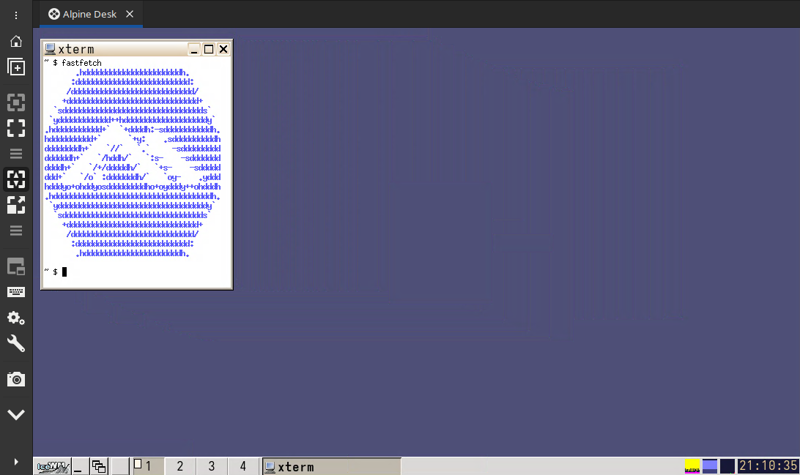

# alpine_desk



#### A docker container with built in Xrdp, with a simple useability in docker compose.
### **How to configure it?**

*Using Docker compose:*
```
services:
    desk:
        image: ghcr.io/xycertbsi/alpine_desk:main   # the image you can build from Dockerfile
        container_name: alpine_desk # the name of it 
        
        environment:
            - XRDP_USER=groot  # the xrdp user with you can login
            - XRDP_PASSWORD=1234 # the xrdp user password
            - XRDP_SESSION=icewm-session # the session that be executed

            - PLUS_PACKAGES=icewm  # what you type here gets installed
            - XRDP_USER_GROUPS=bin daemon sys adm disk wheel floppy dialout tape video # the groups that be added to your XRDP user

        ports:
            - 8000:2000 # outside_port:2000 -> your alpine_desk is be running on :8000
```
---
*Using Docker cli:*
```
docker run -d -p 8000:2000 --name alpine_desk \
  -e XRDP_USER=groot \
  -e XRDP_PASSWORD=1234 \
  -e XRDP_SESSION="icewm-session" \
  -e PLUS_PACKAGES="icewm" \
  -e XRDP_USER_GROUPS="bin daemon sys adm disk wheel floppy dialout tape video" \
  xycert:alpine_desk
```

### Structure:
```
- 'import' folder: The files are used by Dockerfile.
  - 'xrdp.ini': This gets automatically copied 
    to the /etc/xrdp inside the container at building.
    
  - 'entrypoint.sh': Entrypoint: Handles User setup, 
    sets sudoers, starts xrdp(-sesman), 
    fixes executable errors and sets .xinitrc.
  
- 'docker-compose.example.yml': Docker compose example.
- 'Dockerfile': Dockerfile.
```

### Building:
```
docker build . -t xycert:alpine_desk
```

**You can just open a bash shell of course for configureing/installing.**
```
host@hostuser $ docker exec -it alpine_desk /bin/bash
6f66552ca3ae:/# apk update
v3.24.4-127-gced0c71f993 [https://dl-cdn.alpinelinux.org/alpine/v3.24/main]
v3.24.4-130-gb1b3bfe3756 [https://dl-cdn.alpinelinux.org/alpine/v3.24/community]
OK: 28673 distinct packages available
6f66552ca3ae:/# exit
host@hostuser $
```

#### Contribute:
- You find any sort of **bugs**, **errors** please open a **issue**!
- You have a **idea**, **better modes** to do something open issue with **idea label**!

- I very honor the **ideas** and **bug fix reports**! ❤️ @xycertbsi

**This repo its not contain any AI generated code.**
